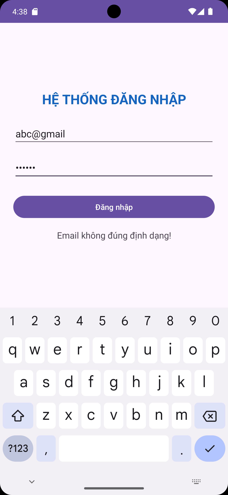
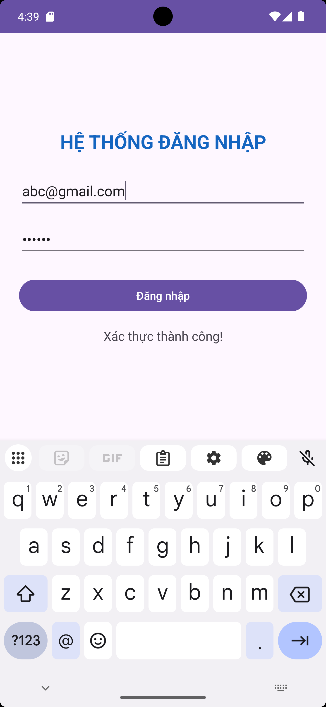
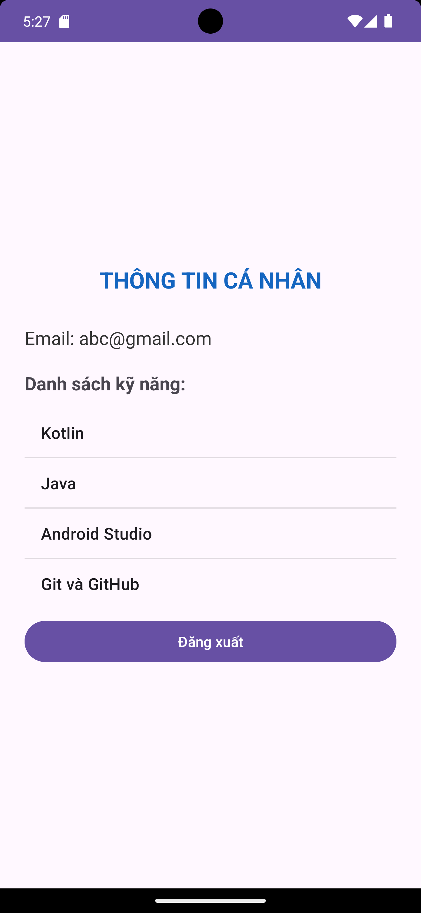
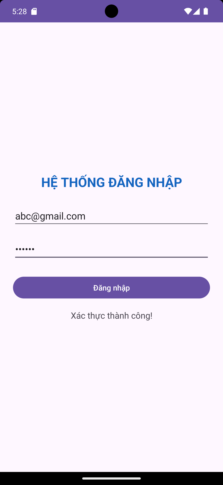
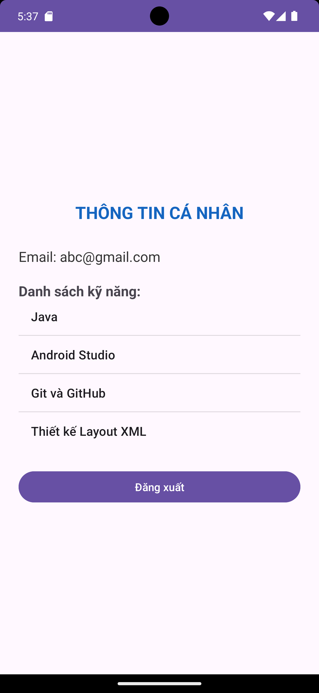
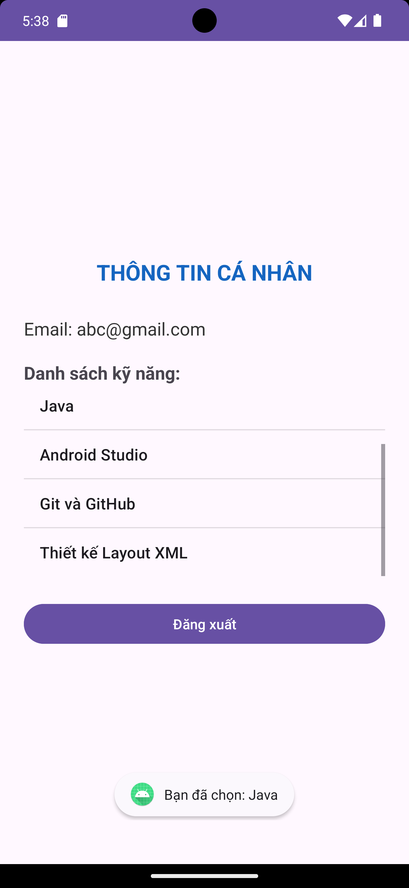

# BÀI THI THỰC HÀNH - LẬP TRÌNH ỨNG DỤNG DI ĐỘNG

- Họ và tên: Phan Thanh Tùng
- MSSV: 2474802010537

## Minh chứng Câu 1

### Kiểm tra dữ liệu không hợp lệ

### Xác thực thành công

## Minh chứng Câu 2

### Màn hình ProfileActivity nhận Email từ LoginActivity

### Chức năng đăng xuất

## Minh chứng Câu 3

### Danh sách ListView hiển thị các kỹ năng

### Toast khi chọn một kỹ năng

